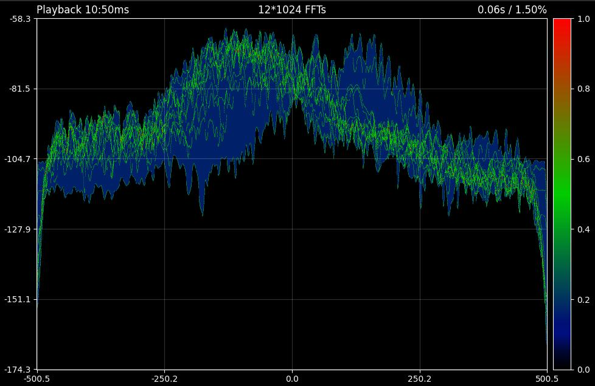

# RPPS
 RF Parameter Processor Suite

RPPS is a generic signal processor/generator library.
 - [Documentation](https://anonoei.github.io/RPPS/)
 - [PyPI](https://pypi.org/project/rpps/)

## Usage

Everything is driven by operators: `*` encodes / modulates / scrambles, `/` undoes it, `+` runs a DSP stage.
The data carries its sample rate and the state of every stage from block to block (see "Things that surprise people" below).

### Bits to symbols and back ([file](https://github.com/Anonoei/RPPS/tree/main/tests/example.py))
```python
import rpps as rp

mod = rp.symbol.load("psk/qpsk")       # first bit map; load("psk/qpsk", "R090 inverted") for a rotated / spectrally inverted one. Or rp.symbol.generate("16QAM"), rp.symbol.PSK(8), rp.symbol.APSK(32)
ecc = rp.code.Hamming(7, 4)       # or rp.code.load("block/hamming/7_4")
scr = rp.code.scram.load("v35")

msg = rp.Data(b"Hello World!")
syms = msg * scr * ecc * mod        # Scramble, encode, modulate
out = syms / mod / ecc / scr        # Demodulate, decode, descramble
assert out.as_bytes().hex == msg.as_bytes().hex

# Pipes multiplied together make a reusable link, decoded in the opposite order
link = scr * ecc * mod
syms = msg * link
out = syms / link
```

### Receiving a signal
```python
# docs: skip
src = rp.source.File("ci32t", "capture.cs16", Fs=100e6, cf=1.0e9)       # or rp.source.Device("hackrf", cf=..., Fs=...)
rx = (rp.signal.filters.ShiftFreq(22.3e6)  + rp.signal.filters.low_pass(401, 3e6, 100e6) + rp.signal.sample.down.Decimate(8)
      + rp.sync.Acquire() + rp.sync.time.Mat() + rp.sync.phase.FFCarrier())     # stages added together make a pipeline

for out in src(16384) + rx:          # blocks flow through, state carried from one to the next
    print(out.Fs, out.sps, out.det)  # rates follow the stages; Acquire's detection is on the data

src(16384) + rx >> rp.source.Sink("cf64", "symbols.iq")       # or straight into a file
```
A stage can also be applied by hand to a block: `blk + rp.signal.filters.ShiftFreq(1e3)`.
`rp.signal.channel` has impairments to test against (`AWGN`, `CFO`, `Fading`, `Multipath`, `ClockDrift`...).

### A known signal: profiles
A profile is one JSON file that describes a whole signal, both directions: its steps in receive order (filters, sync,
pulse, modulation, codes, framing) and the parameters a header may change along the way.
```python
# docs: skip
p = rp.profile.load("ble/adv", channel=38)                 # or dvbs2/normal, adsb/mode_s, ax25/afsk1200, ccsds/tm_rs, ieee80211b/long...
for pdu in rp.source.File("cf64", "ch38.cf64", Fs=4e6, cf=2426e6)(65536) + p.rx():
    print(pdu.as_bytes().hex, pdu.stream.est["ble_adv"]["last"])        # the payloads of the packets whose CRC checks, and their header fields
wave = p.tx()(rp.Data(bytes(31)), fields={"type": 2})                   # the same file transmits: the steps inverted, in reverse
```
`python -m rpps ls profile` lists the shipped profiles, `python -m rpps steps` the step kinds and sync methods a profile
can name, `python -m rpps rx ble/adv capture.cf64 --fs 4e6 --param channel=38` receives a file from the shell. A new signal
is a new file in `config/profile/<family>/<mode>.json` (or in your own config directory, `rp.add_config_path`), built from
the shipped definitions: constellations, pulses, codes, scramblers, sequences, headers. Writing one needs no code; see
[README.dev.md](README.dev.md#profiles) for the format and the step kinds.

### Things that surprise people
- **What `rp.Data` makes of an array.** `bytes` and `uint8` arrays are bytes (`[0, 1, 1, 0]` as uint8 is 32 bits); bits
  are `bool` (an int 0/1 array is an error, not bits); a float array is real samples, never LLRs; `complex64` with
  `sps=1` is symbols, `complex128` stays samples. `Fs` defaults to 1.0.
- **Partial blocks wait.** A code or constellation keeps what doesn't fill a block in the data's context until more
  comes or the block is flushed: three bits through QPSK give one symbol, or two with `rp.Data(bits, flush=True)`.
- **Two kinds of carried state.** A `Stage` (`+`) keeps its state in the stream: pass `stream=prev.stream` to go on.
  A `Pipe` (`*`, `/`) keeps it in the context: `ctx=prev.ctx`. A fresh `rp.Data(chunk)` starts both over. Iterating a
  source does this for you.
- **Some state lives on the operator.** `Feedthrough.encode(array)` called directly moves the register (`reset()` starts
  it over); `control()` changes the operator for everyone holding it; decode status (`code.errors`, `crc.ok`) is the
  last call's, on shared cached objects.
- **Bits to a link layer go through `rp.code.Uncoded()`.** `syms / qpsk / crc` is an error: channel bits are not data
  bits until a code (or `Uncoded`) says so.
- **LLRs are log(P0/P1)**: positive means 0, a hard decision is `llr < 0`.
- **Bit order is most significant first** (bytes, constellation labels, RS symbols, markers), except HDLC bytes on the
  wire (least significant first), recurrence `init` integers (`lsb` unless `"order": "msb"`) and headers that say `"lsb"`.
- **Shapes and definitions are separate.** `rp.symbol.load("psk/qpsk")` reads a definition; `rp.symbol.generate("16QAM")`
  makes a shape; DVB-S2's 16APSK is `rp.symbol.load("apsk/dvbs2_16apsk_3_4")`, not `generate("16APSK")`.

### Real time
```python
# docs: skip
blocks = rp.source.Device("hackrf", cf=915e6, Fs=10e6)(65536).threaded(drop=True) # the radio is read in a thread of its own
for out in blocks.pipelined(rx):     # and every stage of rx runs in its own thread
    ...
print(out.stream.load())             # time each stage takes, as a fraction of real time (over 1.0: too slow)
```
The per-sample loops (AGC, Costas, timing recovery, equalizers, IIR, demodulators) and the decoders (Viterbi, trellis,
BCJR / turbo, LDPC, Reed-Solomon, BCH) run in C++ (`rpps._native`, built with the package) and release the GIL, so
threads run them in parallel; batches of codewords are spread over the cores (`RPPS_THREADS` sets how many).
Without a compiler RPPS uses its Python loops (the reference: `RPPS_NO_NATIVE=1` forces them). Compare with
`python tests/bench_stages.py`.

### Real-time spectrum

- [file](https://github.com/Anonoei/RPPS/tree/main/tests/dev/viz_rt.py)

## Install
1. Run `python3 -m pip install rpps` (`rpps[viz]` adds matplotlib for `rp.viz`). From a checkout, `python builder.py -c`
   (or `python setup.py build_ext -i`) builds the C++ kernels in place; it needs pybind11 and a C++17 compiler
2. In your project, `import rpps as rp`

Definitions (codes, scramblers, modulations) ship with the package. Add your own without touching it:
`rp.add_config_path("my_config")` (laid out like `src/rpps/config`) or set `RPPS_CONFIG`.
Logging is off until you ask: `rp.logger.enable("DEBUG")`.

## Roadmap
 - [ ] [Source](https://github.com/Anonoei/RPPS/tree/main/src/rpps/source)
   - [X] File
   - [ ] (Linux only) tun/tap
   - [ ] Socket
 - [ ] [Filters](https://github.com/Anonoei/RPPS/tree/main/src/rpps/signal/filters)
   - [X] Pulse Shaping (rrc, rc, halfsine, gaussian, rect)
   - [X] Window functions
   - [X] Designed in a profile (lowpass, bandpass... in Hz), channelizer, resampler, spectral inversion
 - [X] [Sample](https://github.com/Anonoei/RPPS/tree/main/src/rpps/signal/sample)
 - [ ] [Sync](https://github.com/Anonoei/RPPS/tree/main/src/rpps/sync)
   - [X] Frequency
   - [X] Phase (M-th power, Costas, pilots)
   - [X] Time (Oerder & Meyr, Mueller & Muller, Gardner, timing locked loop)
   - [X] Frames: preambles among symbols, delimiter words among bits (fixed or header-driven length, polarity), repeating markers
 - [X] [Symbol](https://github.com/Anonoei/RPPS/tree/main/src/rpps/symbol)
   - [X] PSK
   - [X] QAM
   - [X] APSK
   - [X] ASK
   - [X] FSK
 - [ ] [Code](https://github.com/Anonoei/RPPS/tree/main/src/rpps/code)
   - [ ] Block
     - [X] Repetition
     - [X] Hamming (decoded on its syndrome trellis)
     - [X] BCH
     - [X] Reed-Solomon
     - [X] LDPC (layered min-sum; DVB-S2 tables, quasi-cyclic matrices: IEEE 802.11n)
     - [ ] TPC
   - [X] Convolutional
     - [X] Viterbi (hard and soft)
     - [X] BCJR / trellis (log-MAP, max-log-MAP)
   - [X] Soft decisions (demodulator LLRs into the decoders)
 - [ ] [Scramblers](https://github.com/Anonoei/RPPS/tree/main/src/rpps/code/scram)
   - [X] fibonacci
   - [X] galois
   - [X] V.35
   - [X] Line codes: NRZI, NRZ-M, Manchester, inversion; sync markers (CCSDS ASM, preambles) attached and stripped
 - [ ] [Link](https://github.com/Anonoei/RPPS/tree/main/src/rpps/link)
   - [X] CRC
   - [X] HDLC (streaming, any block cut)
   - [X] Headers: fields, a CRC over them or a frame check sequence over header and payload, header-driven lengths
   - [ ] PPP
 - [ ] [Profiles](https://github.com/Anonoei/RPPS/tree/main/config/profile): DVB-S, DVB-S2, IEEE 802.11b, IEEE 802.15.4, Bluetooth LE advertising, Mode S / ADS-B, AX.25 AFSK, CCSDS telemetry (Reed-Solomon)
 - [X] [Viz](https://github.com/Anonoei/RPPS/tree/main/src/rpps/viz): time, frequency, eye, constellation, spectrogram, survey

## Contributing
See [README.dev.md](README.dev.md) for the design, how the project is organized and implemented, and how to add to it.
 1. `git clone https://github.com/Anonoei/RPPS`
 2. `cd RPPS`
 3. `git branch -c feature/<your feature>`
 4. `python3 builder.py -s -c` installs rpps editable with its dev dependencies and builds the C++ kernels
 5. run `python3 -m pytest` (add `-m "not slow"` to skip the chain tests). Scratch scripts live in `tests/dev`
 6. Check out the `dev` branch for latest changes
