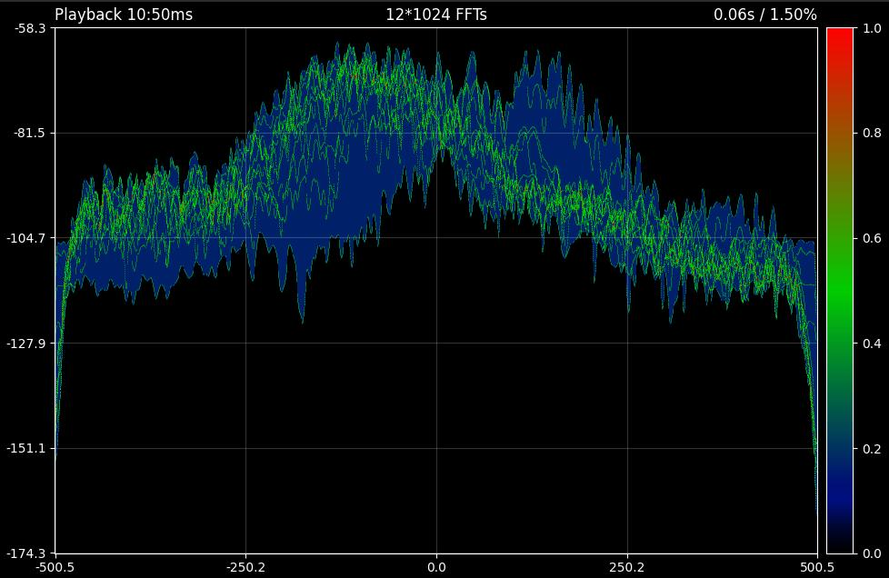

# RPPS
 RF Parameter Processor Suite

RPPS is a generic signal processor/generator library.
 - [Documentation](https://anonoei.github.io/RPPS/)
 - [PyPI](https://pypi.org/project/rpps/)

## Usage

Everything is driven by operators: `*` encodes / modulates / scrambles, `/` undoes it, `+` runs a DSP stage.
The data carries its sample rate and the state of every stage, so there is nothing to set up or reset.

### Bits to symbols and back ([file](https://github.com/Anonoei/RPPS/tree/main/tests/example.py))
```python
import rpps as rp

mod = rp.symbol.load("QPSK")           # first bit map; load("QPSK", "R090 inverted") for a rotated / spectrally inverted one. Or rp.symbol.QAM(16), rp.symbol.PSK(8), rp.symbol.APSK(32), or any point set from a config file
ecc = rp.code.Hamming(7, 4)       # or rp.code.load("block", "hamming/7_4")
scr = rp.code.scram.load("v35")

msg = rp.Data(b"Hello World!")
syms = msg * scr * ecc * mod        # Scramble, encode, modulate
out = syms / mod / ecc / scr        # Demodulate, decode, descramble
assert out.as_bytes().hex == msg.as_bytes().hex

# Pipes multiplied together make a reusable link, decoded in the opposite order
link = scr * ecc * mod
syms = msg * link
out = syms / link
```

### Receiving a signal
```python
# docs: skip
src = rp.source.File("ci32t", "capture.cs16", Fs=100e6, cf=1.0e9)       # or rp.source.Device("hackrf", cf=..., Fs=...)
rx = (rp.signal.filters.ShiftFreq(22.3e6)  + rp.signal.filters.low_pass(401, 3e6, 100e6) + rp.signal.sample.down.Decimate(8)
      + rp.sync.Acquire() + rp.sync.time.Mat() + rp.sync.phase.FFCarrier())     # stages added together make a pipeline

for out in src(16384) + rx:          # blocks flow through, state carried from one to the next
    print(out.Fs, out.sps, out.det)  # rates follow the stages; Acquire's detection is on the data

src(16384) + rx >> rp.source.Sink("cf64", "symbols.iq")       # or straight into a file
```
A stage can also be applied by hand to a block: `blk + rp.signal.filters.ShiftFreq(1e3)`.
`rp.signal.channel` has impairments to test against (`AWGN`, `CFO`, `Fading`, `Multipath`, `ClockDrift`...).

### Real time
```python
# docs: skip
blocks = rp.source.Device("hackrf", cf=915e6, Fs=10e6)(65536).threaded(drop=True) # the radio is read in a thread of its own
for out in blocks.pipelined(rx):     # and every stage of rx runs in its own thread
    ...
print(out.stream.load())             # time each stage takes, as a fraction of real time (over 1.0: too slow)
```
The per-sample loops (AGC, Costas, timing recovery, equalizers, IIR, demodulators) and the decoders (Viterbi, trellis,
BCJR / turbo, LDPC, Reed-Solomon, BCH) run in C++ (`rpps._native`, built with the package) and release the GIL, so
threads run them in parallel; batches of codewords are spread over the cores (`RPPS_THREADS` sets how many).
Without a compiler RPPS uses its Python loops (the reference: `RPPS_NO_NATIVE=1` forces them). Compare with
`python tests/bench_stages.py`.

### Real-time spectrum

- [file](https://github.com/Anonoei/RPPS/tree/main/tests/dev/viz_rt.py)

## Install
1. Run `python3 -m pip install rpps` (`rpps[viz]` adds matplotlib for `rp.viz`). From a checkout, `python builder.py -c`
   (or `python setup.py build_ext -i`) builds the C++ kernels in place; it needs pybind11 and a C++17 compiler
2. In your project, `import rpps as rp`

Definitions (codes, scramblers, modulations) ship with the package. Add your own without touching it:
`rp.add_config_path("my_config")` (laid out like `src/rpps/config`) or set `RPPS_CONFIG`.
Logging is off until you ask: `rp.logger.enable("DEBUG")`.

## Roadmap
 - [ ] [Serial](https://github.com/Anonoei/RPPS/tree/main/src/rpps/serial)
   - [X] File
   - [ ] (Linux only) tun/tap
   - [ ] Socket
 - [ ] [Filters](https://github.com/Anonoei/RPPS/tree/main/src/rpps/filters)
   - [X] Pulse Shaping
   - [X] Window functions
 - [X] [Sample](https://github.com/Anonoei/RPPS/tree/main/src/rpps/sample)
 - [ ] [Sync](https://github.com/Anonoei/RPPS/tree/main/src/rpps/sync)
   - [X] Frequency
   - [ ] Phase
   - [ ] Time
 - [X] [Mod](https://github.com/Anonoei/RPPS/tree/main/src/rpps/mod)
   - [X] PSK
   - [X] QAM
   - [X] APSK
   - [X] ASK
   - [X] FSK
 - [ ] [Coding](https://github.com/Anonoei/RPPS/tree/main/src/rpps/coding)
   - [ ] Block
     - [X] Repetition
     - [X] Hamming (decoded on its syndrome trellis)
     - [X] BCH
     - [X] Reed-Solomon
     - [X] LDPC (min-sum, DVB-S2 tables)
     - [ ] TPC
   - [X] Convolutional
     - [X] Viterbi (hard and soft)
     - [X] BCJR / trellis (log-MAP, max-log-MAP)
   - [X] Soft decisions (demodulator LLRs into the decoders)
 - [ ] [Scram](https://github.com/Anonoei/RPPS/tree/main/src/rpps/scram)
   - [X] fibonacci
   - [X] galois
   - [X] V.35
 - [ ] [Encapsulation](https://github.com/Anonoei/RPPS/tree/main/src/rpps/encap)
   - [X] CRC
   - [X] HDLC
   - [ ] PPP
 - [ ] [Viz](https://github.com/Anonoei/RPPS/tree/main/src/rpps/viz)
   - [X] Real-Time (STFT)
   - [X] Over-Time

## Contributing
 1. `git clone https://github.com/Anonoei/RPPS`
 2. `cd RPPS`
 3. `git branch -c feature/<your feature>`
 4. `python3 builder.py -b -l` build and install rpps locally
    - This also installs deps, and dev_deps automatically
 5. run `python3 -m pytest` (add `-m "not slow"` to skip the chain tests). Scratch scripts live in `tests/dev`
 6. Check out the `dev` branch for latest changes
